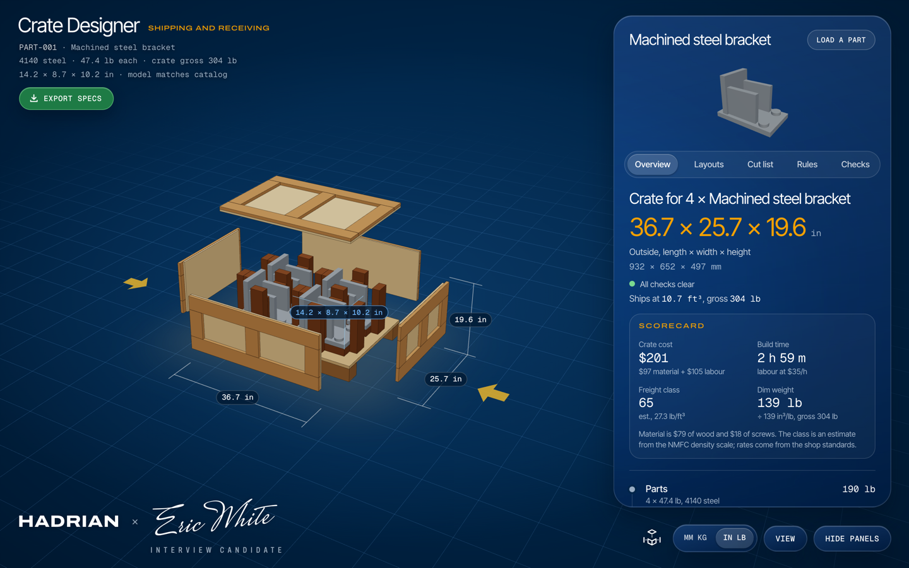
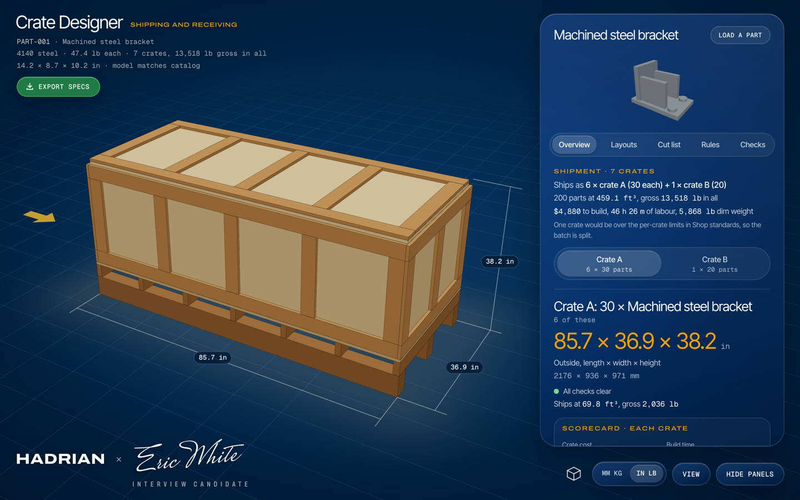
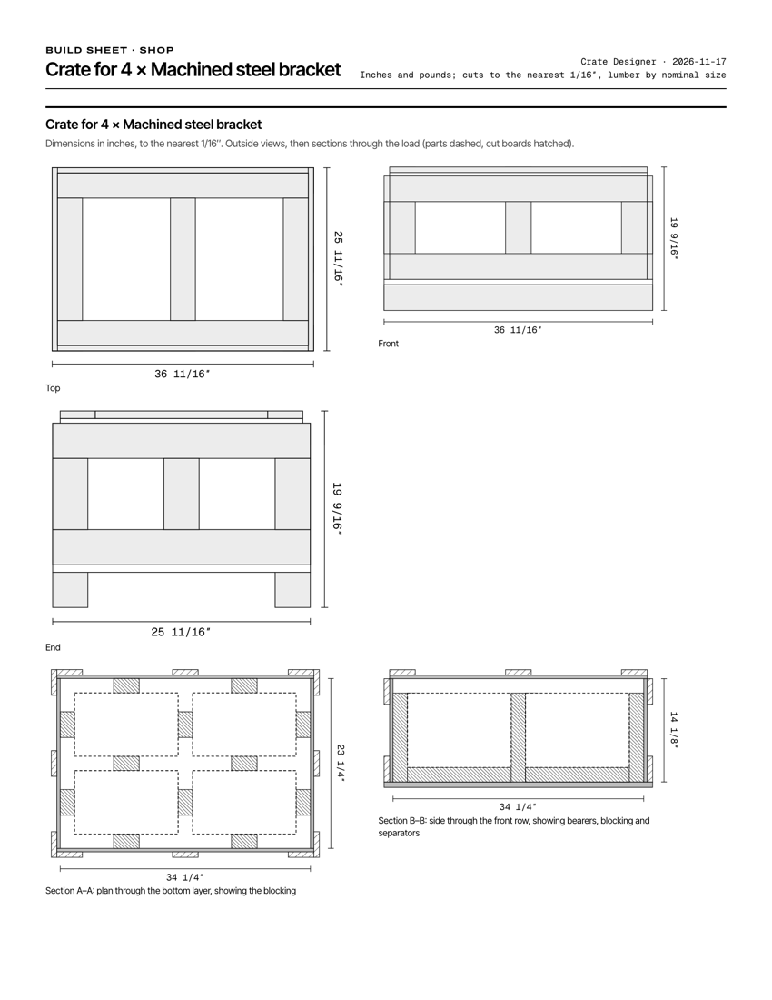

# Crate Designer

[](https://github.com/0xevm1/shipping-ui/actions/workflows/ci.yml)
[](https://nextjs.org)
[](https://react.dev)
[](https://www.typescriptlang.org)
[](https://threejs.org)
[](https://bun.sh)
[](https://www.postgresql.org)

A browser app that designs **custom wooden shipping crates** for one or more identical machined
parts. Load a part (a GLB, with an optional `parts.json` entry) and a quantity: it packs the parts,
builds a crate around them from plywood, lumber and wood screws, shows it in 3D, checks it, prices
it, and exports the packing specs for the shop: a cut list, a build sheet and a shipping label.



| | |
|---|---|
|  |  |

## Installation

Requirements: [Bun](https://bun.sh) 1.3+, Node 24 and Docker (Docker Desktop, or Engine with the
compose plugin), running.

```bash
bun install
bun run dev          # starts Postgres and blob storage in Docker, migrates, serves http://localhost:3000
bun run worker       # optional, in a second terminal: background sweeps and large bundles
```

No environment variables are needed. If port 5432 or 9000 is already in use, copy `.env.example`
to `.env.local` and change `DB_PORT` or `BLOB_PORT`. `bun run dev:app` starts only the web app,
without Docker.

## Documentation

Everything else (commands, environment, the command line, pull requests, who it's for, what it
does, scope, assumptions and the project layout) is in **[docs/GUIDE.md](docs/GUIDE.md)**. The rules
and algorithms are in [docs/SPECIFICATION.md](docs/SPECIFICATION.md). For a short, spoken tour of the
architecture, data model and main decisions, read [docs/architecture.md](docs/architecture.md).
